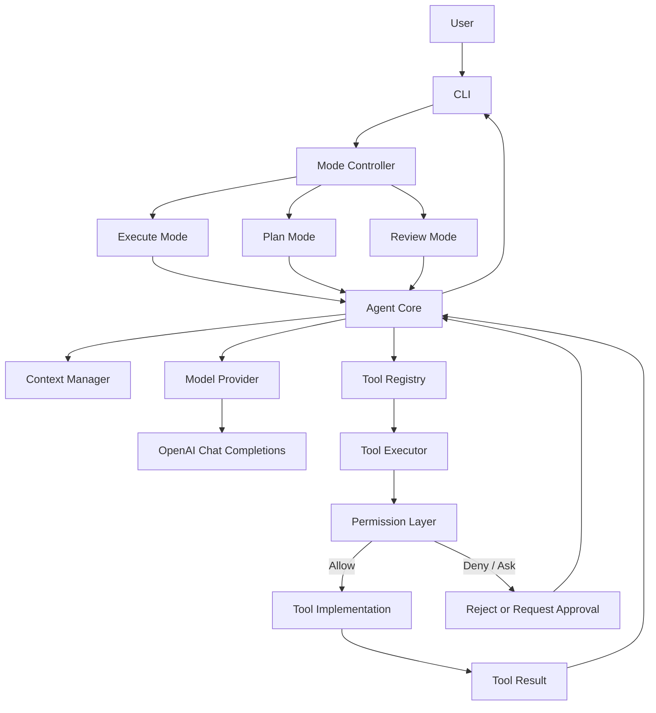

# Go AI Coding Agent

> 文档基线：**V1.1**（技术细节增强修订稿）

一个使用 Go 从零实现的 AI Coding Agent 学习项目。目标是通过渐进式实现，理解模型交互、Agent Loop、工具调用、上下文管理、权限控制、计划与代码审查，以及后续的 Multi-Agent 协作。

## 项目目标

- 先实现可运行、可测试的单 Agent CLI。
- 首个模型接口采用 OpenAI Chat Completions；后续适配 OpenAI Responses API。
- 将模型、工具、上下文、权限和执行环境解耦。
- Plan Mode 与 Review Mode 必须由程序级权限保证只读。
- 先建立安全边界，再逐步开放文件修改和命令执行能力。
- 后续演进为 Plan Agent、Coding Agent、Review Agent 与 Orchestrator。

## 当前技术决策

| 领域 | 当前决策 |
|---|---|
| 语言 | Go |
| 交互入口 | CLI |
| 首个模型 API | OpenAI Chat Completions |
| 后续模型 API | OpenAI Responses API |
| SDK / HTTP | 设计上隔离 Provider；具体实现方式在编码阶段选定 |
| Claude Code / Anthropic API | 当前不接入 |
| Agent 形态 | MVP 单 Agent；后续 Multi-Agent |

## 工作模式

| 模式 | 入口示例 | 目标 | 修改项目 |
|---|---|---|---|
| Execute | `coding-agent "实现功能"` | 在权限策略允许范围内完成任务 | 可能允许，仍受策略约束 |
| Plan | `coding-agent plan "设计功能"` | 阅读、分析、输出实施计划 | 禁止 |
| Review | `coding-agent review ./` | 读取代码并输出审查报告 | 禁止 |

Plan / Review 的只读不是 Prompt 约定，而是 Permission Layer 对能力、路径和副作用进行强制限制的结果。

## 总体架构



**权限调用边界：** Agent Core 提交工具调用；Tool Executor 是唯一工具执行入口，并在调用工具实现前调用 Permission Layer。Permission Layer 只做授权决策，不执行工具。

## 仓库布局

```text
.
├── README.md
├── docs/
│   ├── TECHNICAL_DESIGN.md
│   └── ARCHITECTURE.md
├── cmd/coding-agent/
│   └── main.go
├── internal/
│   ├── agent/
│   ├── provider/
│   ├── context/
│   ├── tool/
│   ├── permission/
│   ├── execution/
│   ├── plan/
│   └── review/
├── configs/
└── go.mod
```

## 开发路线

| 阶段 | 周次 | 交付 |
|---|---:|---|
| 项目骨架与 CLI | 1 | 可运行 CLI、配置和日志 |
| 模型接入 | 2 | Chat Completions Provider |
| 工具协议 | 3 | Tool Schema、Registry、调用解析 |
| Agent Loop | 4 | 模型—工具循环 |
| 只读文件工具与权限基础 | 5 | 工作区约束、读取、搜索 |
| 受控写入与命令执行 | 6 | 授权、执行限制、测试工具 |
| 上下文与安全完善 | 7 | Context Manager、审计、边界测试 |
| MVP 整合 | 8 | 集成测试与可用 CLI |
| Plan / Review Mode | 9 | 单 Agent 下的只读规划和审查 |
| Multi-Agent | 10+ | 专用 Agent、任务交接 |
| Orchestrator | 后续 | 拆解、调度、汇总 |

## 文档导航

- [技术设计文档](docs/TECHNICAL_DESIGN.md)：模块职责、接口草案、数据结构、权限与执行策略、测试和阶段计划。
- [架构文档](docs/ARCHITECTURE.md)：组件关系、调用时序、权限边界和演进架构。

## 核心工程原则

1. 所有工具执行必须经过 Tool Executor。
2. Tool Executor 在执行前调用 Permission Layer；不存在绕过入口。
3. Mode、Workspace 等安全上下文由应用程序创建，模型不能自行提升权限。
4. 能力标签描述工具“能做什么”，不是“已经允许做什么”。
5. Plan / Review 默认只读；用户确认计划不等于授予写权限。
6. 文件路径检查必须考虑规范化、符号链接和竞态风险。
7. 命令执行初期使用 `os/exec` 的参数数组，不默认启用 Shell。
8. 先完成 MVP 所需的最小安全机制，再迭代沙箱、审批和更强隔离。
