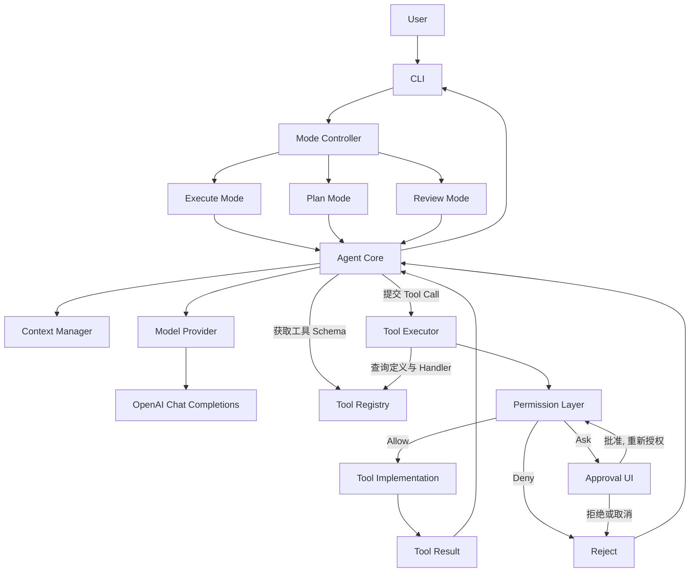

# Go AI Coding Agent

> 文档基线：**V1.2**（单 Agent 纵向闭环修订稿）
>
> 当前状态：设计阶段，代码尚未开始。

一个使用 Go 从零实现的 AI Coding Agent 学习项目。目标是通过渐进式实现，理解模型交互、Agent Loop、工具调用、上下文管理、权限控制、计划与代码审查。当前专注单 Agent，不展开 Multi-Agent 或 Orchestrator。

## 项目目标

- 先实现可运行、可测试的单 Agent CLI。
- 首个模型接口采用 OpenAI Chat Completions；后续适配 OpenAI Responses API。
- 将模型、工具、上下文、权限和执行环境解耦。
- Plan Mode 与 Review Mode 必须由程序级权限保证只读。
- 先建立安全边界，再逐步开放文件修改和命令执行能力。
- 将 Plan / Review 实现为同一 Agent 的只读工作模式。

## 当前技术决策

| 领域 | 当前决策 |
|---|---|
| 语言 | Go |
| 交互入口 | CLI |
| 首个模型 API | OpenAI Chat Completions |
| 后续模型 API | OpenAI Responses API |
| SDK / HTTP | 设计上隔离 Provider；具体实现方式在编码阶段选定 |
| Claude Code / Anthropic API | 当前不接入 |
| Agent 形态 | 单 Agent；Plan / Review 为工作模式 |

## 工作模式

| 模式 | 入口示例 | 目标 | 修改项目 |
|---|---|---|---|
| Execute | `coding-agent "实现功能"` | 在权限策略允许范围内完成任务 | 可能允许，仍受策略约束 |
| Plan | `coding-agent plan "设计功能"` | 阅读、分析、输出实施计划 | 禁止 |
| Review | `coding-agent review ./` | 读取代码并输出审查报告 | 禁止 |

Plan / Review 的只读不是 Prompt 约定，而是 Permission Layer 对能力、路径和副作用进行强制限制的结果。

## 总体架构



**权限调用边界：** Agent Core 提交工具调用；Tool Executor 是唯一工具执行入口，并在调用工具实现前调用 Permission Layer。Permission Layer 只做授权决策，不执行工具。

## 仓库布局

```text
.
├── README.md
├── docs/
│   ├── TECHNICAL_DESIGN.md
│   └── ARCHITECTURE.md
├── cmd/coding-agent/
│   └── main.go
├── internal/
│   ├── cli/
│   ├── config/
│   ├── agent/
│   ├── provider/
│   ├── ctxmgr/
│   ├── tool/
│   ├── executor/
│   ├── permission/
│   └── audit/
├── configs/
└── go.mod
```

## 开发路线

| 阶段 | 学习重点 | 可运行交付 |
|---|---|---|
| M1：单轮模型调用 | CLI、配置、Provider、Mock、`--debug` | 完成一次真实请求，错误可诊断；逐轮可见完整上下文、Token 与耗时 |
| M2：最小只读闭环 | Tool Schema、Registry、Executor、基础权限、基础 Agent Loop | Agent 使用读取或列表工具读取 `go.mod` 并总结项目 |
| M3：Loop 与上下文加固 | 多 Tool Call、错误反馈、取消、预算、Context Manager | 畸形参数和工具失败可恢复，超长输出受控，Loop 能可靠终止 |
| M4：Plan / Review | Mode、只读权限、结构化提交 | 同一 Agent 可规划和审查，写入与命令被硬性拒绝 |
| M5：受控写入与审批 | 锚点编辑、Ask 审批、审计 | 在临时 Git 仓库完成一次小修改并展示 Diff |
| M6：命令与 MVP 验收 | 受控测试命令、进程限制、任务级评测 | 端到端完成“修改—验证—总结”，安全和集成测试通过 |

每个阶段都形成可运行、可观察的纵向闭环；详细职责和验收标准见技术设计文档。

## 运行（M1 完成后可用）

- Go 1.22 及以上。
- `OPENAI_API_KEY` 从环境变量读取，不写入仓库与日志。

```bash
go run ./cmd/coding-agent --debug "读取 go.mod 并总结这个项目"
go run ./cmd/coding-agent plan "设计配置加载模块"
```

## 文档导航

- [技术设计文档](docs/TECHNICAL_DESIGN.md)：模块职责、Agent Loop、Context Manager、接口草案、权限与执行策略、测试和阶段验收。
- [架构文档](docs/ARCHITECTURE.md)：组件关系、调用时序、权限边界和安全约束。

## 核心工程原则

完整定义见技术设计文档「2.2 规范条目表」，此处只列最关键的约束：

1. 所有工具执行必须经过 Tool Executor；Permission Layer 只做决策、不执行工具。（R-01、R-02）
2. Mode、Workspace、PolicyID 由应用创建，模型不能提升权限；Plan / Review 只暴露只读与提交工具，并硬性拒绝写操作。（R-04、R-05）
3. Deny、审批拒绝或取消时工具实现调用次数为零；Ask 批准后必须对原请求重新授权。（R-06、R-07）
4. 能力标签只描述“能做什么”，不表示“已允许”；未知一律拒绝。（R-03、R-09）
5. 路径检查考虑规范化、符号链接和竞态；写入必须先读后写并校验内容哈希。（R-10、R-11、R-12）
6. 命令使用参数数组与白名单，不默认 Shell；策略约束不等于系统隔离。（R-13、R-14）
7. 上下文、工具输出和预算必须有上限；Tool Call 与 Tool Result 必须配对。（R-15、R-16、R-17）
8. 审计可解释、可脱敏；敏感文件默认不读取、不外发给模型。（R-18、R-19）
