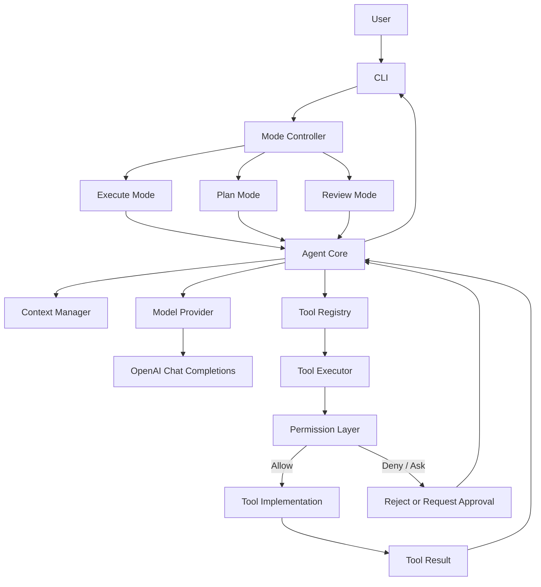
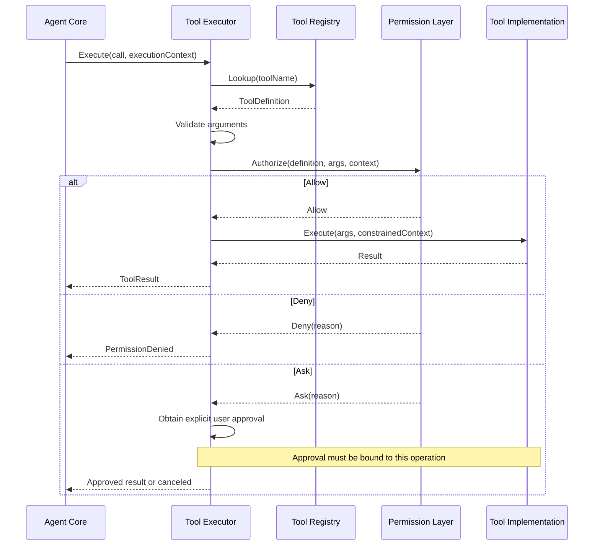
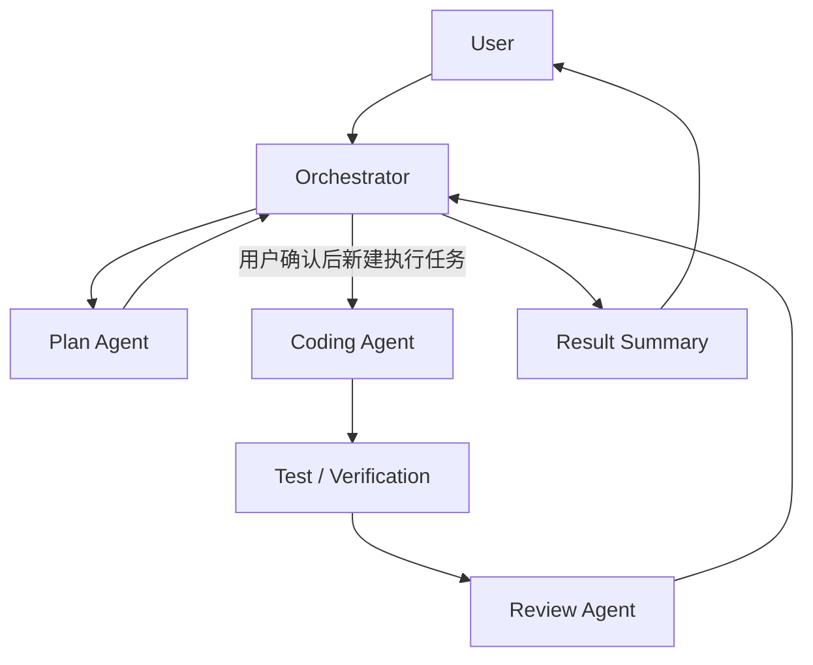

# Go AI Coding Agent — 架构文档

> 文档基线：**V1.1**（技术细节增强修订稿）

## 1. 架构目标

以单 Agent MVP 为基础，明确模型、模式、上下文、工具注册、工具执行和权限决策的边界。所有工具执行必须经过统一执行入口；只读模式必须在程序层强制执行。

## 2. 总体架构



README 与本图采用相同组件集合和 `Tool Registry → Tool Executor → Permission Layer → Tool Implementation` 顺序。

## 3. 组件职责与依赖方向

| 组件 | 职责 | 不负责 |
|---|---|---|
| CLI | 参数解析、配置、展示 | 直接执行工具 |
| Mode Controller | 选择 Execute / Plan / Review | 接受模型修改 Mode |
| Agent Core | Agent Loop、任务组织 | 直接调用工具实现或重复授权 |
| Model Provider | 模型 API 适配 | 权限决策 |
| Context Manager | 上下文组装、裁剪 | 提升权限 |
| Tool Registry | 工具定义、Schema、能力和风险元数据 | 授权 |
| Tool Executor | 参数验证、授权调用、执行和结果封装 | 自行绕过策略 |
| Permission Layer | Allow / Deny / Ask 决策 | 执行工具 |
| Tool Implementation | 完成具体文件、搜索或命令操作 | 绕过 Executor |

依赖方向原则：Agent Core 依赖 Provider、Registry 和 Executor 的抽象；Permission Layer 不依赖模型；工具实现不反向调用 Agent Core。

## 4. 可信执行上下文

应用层创建并传递上下文：
```go
type ExecutionContext struct {
    SessionID string
    TaskID    string
    Mode      AgentMode
    Workspace string
    PolicyID  string
    DryRun    bool
}
```

Mode、Workspace、PolicyID 是可信应用上下文，不是模型输入。模型不能通过 Tool Call 改写它们。多 Agent 阶段，每个子 Agent 的上下文必须是父任务权限的子集。

## 5. 工具注册与能力模型

```go
type ToolDefinition struct {
    Name         string
    Description  string
    Parameters   json.RawMessage
    Risk         ToolRisk
    Capabilities []ToolCapability
}
```

Capability 表示工具可能执行的操作，例如 `read_file`、`write_file`、`read_git_diff`、`run_command`。Risk 表示风险等级。二者都是策略输入，不是授权结论。

能力标签由程序注册并校验。Permission Layer 仍须分析参数、目标路径和副作用；不能因一个工具标记为 `read_file` 就忽略其实际参数。

## 6. 权限决策边界与时序

**唯一调用方是 Tool Executor。** Agent Core 提交 Tool Call 并传递 ExecutionContext；Tool Executor 查 Registry、验证参数、调用 Permission Layer；只有 Allow 才调用工具实现。



审批不能绕过硬性禁止规则。Plan / Review 的写操作属于硬性拒绝，不允许通过 Ask 临时放开。

## 7. 权限策略模型

```go
type PermissionDecision string

const (
    DecisionAllow PermissionDecision = "allow"
    DecisionDeny  PermissionDecision = "deny"
    DecisionAsk   PermissionDecision = "ask"
)
```

建议策略评估顺序：
1. 未知工具或能力：Deny。
2. Plan / Review 硬性只读约束：写入和副作用操作 Deny。
3. Workspace 路径和资源边界。
4. Mode 对 Capability 的允许范围。
5. Risk、参数和副作用规则。
6. 用户审批规则。
7. 无规则命中：Deny。

Execute Mode 可根据配置对不同风险操作采取 Allow / Ask / Deny。权限规则应可解释并记录 RuleID。审批应绑定具体工具、参数摘要、目标路径和任务，不能把一次审批泛化成长期全局授权。

## 8. 模式与能力矩阵

| 能力 | Execute | Plan | Review |
|---|---|---|---|
| 列出文件 | 策略允许 | 允许，限 Workspace | 允许，限 Workspace |
| 读取文件 | 策略允许 | 允许，限 Workspace | 允许，限 Workspace |
| 搜索代码 | 策略允许 | 允许，限 Workspace | 允许，限 Workspace |
| 读取 Git Diff | 策略允许 | 允许 | 允许 |
| 写入 / Patch | Allow 或 Ask | 硬性 Deny | 硬性 Deny |
| 删除 / 移动 / 重命名 | Ask 或 Deny | 硬性 Deny | 硬性 Deny |
| 通用命令 | 白名单 / Ask / Deny | 默认 Deny | 默认 Deny |
| 测试命令 | 受控策略 | 默认 Deny | 默认 Deny |
| 网络访问 | 默认 Deny 或 Ask | Deny | Deny |

“读取”不自动等于安全：读取路径仍受 Workspace 限制；命令即使名为测试也可能写缓存、启动服务或访问网络。

## 9. 文件系统安全边界

- Workspace 在任务启动时解析为绝对路径。
- 文件工具应优先接收相对路径。
- 规范化路径并检查是否在 Workspace 内。
- 处理符号链接：解析目标真实路径，拒绝跳出 Workspace 的链接。
- 新建文件时检查父目录真实路径。
- 拒绝设备文件、特殊文件和不支持的路径。
- 不能只用字符串前缀判断目录归属。
- 注意检查与打开之间的 TOCTOU 竞态；MVP 先限制并发和可疑链接，后续采用平台安全 API 或沙箱增强。

## 10. 命令执行边界

MVP 使用 Go `os/exec` 与参数数组，不默认通过 Shell 执行模型拼接字符串。执行器应设置：
- 固定且已验证的工作目录。
- 受控环境变量，不泄露 API Key。
- 超时、取消和输出字节上限。
- 并发上限和进程清理策略。
- 可执行文件 / 子命令白名单。
- 网络访问默认关闭或由独立策略授权。

`exec.CommandContext` 对直接子进程的取消不等于跨平台完整清理进程树，需在各目标操作系统单独验证。

## 11. Plan Mode 与 Review Mode

### Plan Mode

单 Agent 只读模式。只允许列目录、读文件、搜索代码和安全读取 Git 信息。默认禁止写入、Patch、删除、移动、依赖安装、通用命令、网络和任何不确定副作用。

计划结构包含：
- Summary
- Goals / NonGoals
- Steps（文件、依赖、验证方式）
- Risks
- Assumptions
- OpenQuestions
- EstimatedComplexity

用户确认计划不自动授予 Execute 权限。

### Review Mode

单 Agent 只读审查模式。读取代码或 Diff，输出严重级别、文件、行号范围、证据、说明、影响、建议和置信度。初期不自动修复。

## 12. 多 Agent 演进



独立 Agent 不是独立权限域。所有 Agent 仍通过统一 Executor / Permission Layer。子 Agent 获得的能力、路径和预算不得超过父任务授权范围。

## 13. 架构验收标准

- 工具实现不存在绕过 Tool Executor 的调用路径。
- Permission Layer 只由 Tool Executor 调用。
- Deny 时工具实现调用次数为零。
- Plan / Review 无法执行任何项目修改。
- 工具能力和风险标签由应用注册，模型不能伪造。
- 越界路径、符号链接和命令注入测试通过。
- 所有命令具备超时、取消和输出上限。
- 权限决策可解释、可审计。

## 14. 版本说明

保持 **V1.1**。本次补充架构层的上下文传递、能力与风险模型、三态授权、执行边界、文件与命令安全、测试验收和 Multi-Agent 权限继承原则。
