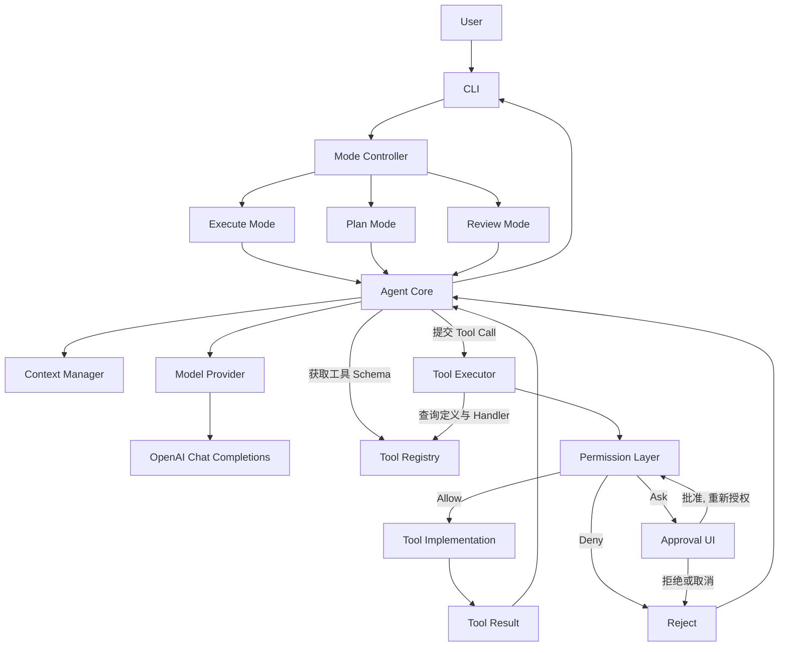
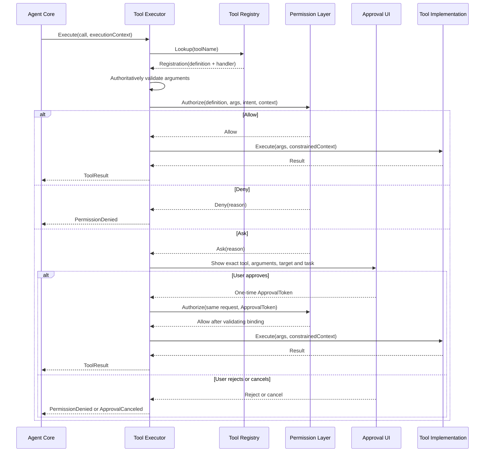

# Go AI Coding Agent — 架构文档

> 文档基线：**V1.2**（单 Agent 纵向闭环修订稿）

## 1. 架构目标

以单 Agent MVP 为基础，明确模型、模式、上下文、工具注册、工具执行和权限决策的边界。所有工具执行必须经过统一执行入口；只读模式必须在程序层强制执行。当前不设计独立 Agent、Multi-Agent 调度或 Orchestrator。

## 2. 总体架构



README 与本图采用相同组件集合。Agent Core 从 Registry 获取工具 Schema，并将 Tool Call 提交给 Executor；Executor 查询 Registry，再按 `Permission Layer → Tool Implementation` 的顺序完成授权与执行。Ask 由 Executor 通过 Approval UI 展示，批准后携带 ApprovalToken 回到 Permission Layer 重新授权，不直接执行工具。

## 3. 组件职责与依赖方向

| 组件 | 职责 | 不负责 |
|---|---|---|
| CLI | 参数解析、配置、展示 | 直接执行工具 |
| Mode Controller | 选择 Execute / Plan / Review | 接受模型修改 Mode |
| Agent Core | Agent Loop、任务组织 | 直接调用工具实现或自行做授权决策 |
| Model Provider | 模型 API 适配 | 权限决策 |
| Context Manager | 上下文组装、裁剪 | 提升权限 |
| Tool Registry | 工具定义、Schema、能力与风险元数据，以及到 Handler 的注册关系 | 授权、执行 |
| Tool Executor | 参数验证、授权调用、执行和结果封装 | 自行绕过策略 |
| Permission Layer | Allow / Deny / Ask 决策 | 执行工具 |
| Tool Implementation | 完成具体文件、搜索或命令操作，只能由 Executor 调用 | 被 Core 或 CLI 直接调用 |

依赖方向原则：Agent Core 依赖 Provider、Registry 和 Executor 的抽象；Executor 依赖 Registry 与 Permission Layer；Registry 不调用 Executor；Permission Layer 不依赖模型；工具实现不反向调用 Agent Core。`permission` 可引用 `tool` 的类型，但 `tool` 不得引用 `permission`；Executor 位于独立的 `executor` 包，负责组装两侧而不引入包循环。

## 4. 可信执行上下文

应用层创建并传递上下文：
```go
type ExecutionContext struct {
    SessionID string
    TaskID    string
    Mode      AgentMode
    Workspace string
    PolicyID  string
    DryRun    bool
}
```

Mode、Workspace、PolicyID 是可信应用上下文，不是模型输入。模型不能通过 Tool Call 改写它们；工具参数中出现同名字段时必须忽略或拒绝。`DryRun` 由应用设置：权限判定照常执行，写操作与命令只预演、不生效；`PolicyID` 标识当前代码内规则集，仅用于审计与解释。

## 5. 工具注册与能力模型

```go
type ToolDefinition struct {
    Name         string
    Description  string
    Parameters   json.RawMessage
    Risk         ToolRisk
    Capabilities []ToolCapability
}
```

Capability 表示工具可能执行的操作，例如 `read_file`、`write_file`、`read_git_diff`、`run_command`。Risk 表示风险等级。二者都是策略输入，不是授权结论。`ToolDefinition` 只含可序列化元数据；Handler 通过 Registry 的注册关系取得，只能由 Executor 调用。

能力标签由程序注册并校验。Executor 根据已验证参数生成 OperationIntent，Permission Layer 据此检查目标路径和副作用；不能因一个工具标记为 `read_file` 就忽略其实际参数。

## 6. 权限决策边界与时序

**唯一调用方是 Tool Executor。** Agent Core 提交 Tool Call 并传递 ExecutionContext；Tool Executor 查 Registry、验证参数、调用 Permission Layer；只有 Allow 才调用工具实现。



首次返回 Ask 时不得执行工具。ApprovalToken 由审批组件生成，绑定工具名、规范化完整参数摘要、目标路径、TaskID、Mode、Workspace 和有效期，只能使用一次，且不能由模型提供。Executor 使用原请求和 Token 重新授权；只有再次获得 Allow 才能执行，参数或安全上下文变化后必须重新审批。审批交互通过 `Approver` 接口注入，CLI 提供终端实现，单元测试使用 Fake；规范化和摘要函数只保留一份，避免两侧不一致导致绑定失效。

审批不能绕过硬性禁止规则。Plan / Review 的写操作属于硬性拒绝，不允许通过 Ask 临时放开。批准、拒绝或取消都必须形成审计事件；拒绝和取消时工具实现调用次数为零。

## 7. 权限策略模型

```go
type PermissionDecision string

const (
    DecisionAllow PermissionDecision = "allow"
    DecisionDeny  PermissionDecision = "deny"
    DecisionAsk   PermissionDecision = "ask"
)
```

建议策略评估顺序（固定顺序，先命中先生效）：
1. 未知工具、未知能力或未知 Mode：Deny。
2. Plan / Review 硬性只读约束：写入和副作用操作 Deny，审批不可放开。
3. Workspace 路径和资源边界。
4. Mode 对 Capability 的允许范围。
5. Risk、参数和副作用规则。
6. 用户审批规则（Ask）。
7. 无规则命中：Deny。

Execute Mode 可根据配置对不同风险操作采取 Allow / Ask / Deny。权限规则应可解释并记录 RuleID。审批应绑定具体工具、参数摘要、目标路径和任务，不能把一次审批泛化成长期全局授权。

## 8. 模式与能力矩阵

| 能力 | Execute | Plan | Review |
|---|---|---|---|
| 列出文件 | 策略允许 | 允许，限 Workspace | 允许，限 Workspace |
| 读取文件 | 策略允许 | 允许，限 Workspace | 允许，限 Workspace |
| 搜索代码 | 策略允许 | 允许，限 Workspace | 允许，限 Workspace |
| 读取 Git Diff | 策略允许 | 允许 | 允许 |
| 结构化提交（`submit_plan` / `submit_review`） | 允许 | 允许（仅提交计划） | 允许（仅提交报告） |
| 写入 / Patch | Allow 或 Ask（MVP 为锚点编辑） | 硬性 Deny | 硬性 Deny |
| 删除 / 移动 / 重命名 | Ask 或 Deny（MVP 不注册） | 硬性 Deny | 硬性 Deny |
| 通用命令 | 仅白名单内 Allow / Ask；非白名单 Deny | 默认 Deny | 默认 Deny |
| 测试命令 | 受控策略（白名单内 Allow / Ask） | 默认 Deny | 默认 Deny |
| 网络访问 | Deny（MVP 不提供放开路径） | Deny | Deny |

“读取”不自动等于安全：读取路径仍受 Workspace 限制；命令即使名为测试也可能写缓存、启动服务或访问网络。Plan / Review 的任务级工具视图不向模型暴露写工具与命令工具，权限层硬拒绝作为兜底；MVP 不注册删除、移动、重命名工具，对应调用按未知工具 Deny。

## 9. 文件系统安全边界

- Workspace 在任务启动时解析为绝对路径。
- 文件工具应优先接收相对路径。
- 规范化路径并检查是否在 Workspace 内。
- 处理符号链接：解析目标真实路径，拒绝跳出 Workspace 的链接。
- 新建文件时检查父目录真实路径。
- 拒绝设备文件、特殊文件和不支持的路径。
- 默认拒绝读取敏感文件模式（如 `.env`、`*.pem`、`id_rsa` 和云厂商凭据文件），避免内容被发送到模型服务；确需读取时由策略显式放行并记录审计。
- 不能只用字符串前缀判断目录归属。
- 注意检查与打开之间的 TOCTOU 竞态；MVP 先限制并发和可疑链接，后续采用平台安全 API 或沙箱增强。

## 10. 命令执行边界

MVP 使用 Go `os/exec` 与参数数组，不默认通过 Shell 执行模型拼接字符串。执行器应设置：
- 固定且已验证的工作目录。
- 受控环境变量，不泄露 API Key。
- 超时、取消和输出字节上限。
- 并发上限和进程清理策略。
- 可执行文件 / 子命令白名单。
- 网络访问在策略层默认拒绝；MVP 不提供放开路径。

必须区分策略约束与系统隔离：子进程继承当前用户的主机权限。`cmd.Dir` 只决定启动目录，不能阻止绝对路径访问；参数数组只能避免默认 Shell 解析，不能限制程序自身行为；`network_access` 标签也不会关闭进程网络。因此，未使用沙箱时，Workspace 不是子进程的文件系统边界，网络拒绝也不是操作系统级强制保证。

MVP 只开放显式白名单或专用测试工具，在临时测试仓库中运行，并向用户展示实际可执行文件与参数。白名单之外不存在审批放行路径：Ask 只能对白名单内的具体命令做二次确认。不要把不可信仓库中的脚本视为安全命令。需要强制文件系统或网络隔离时，必须引入容器、沙箱或操作系统机制。

`exec.CommandContext` 对直接子进程的取消不等于跨平台完整清理进程树，需在各目标操作系统单独验证。

## 11. Plan Mode 与 Review Mode

### Plan Mode

单 Agent 只读模式。只允许列目录、读文件、搜索代码和安全读取 Git 信息。默认禁止写入、Patch、删除、移动、依赖安装、通用命令、网络和任何不确定副作用。

计划结构包含：
- Summary
- Goals / NonGoals
- Steps（文件、依赖、验证方式）
- Risks
- Assumptions
- OpenQuestions
- EstimatedComplexity

计划通过 `submit_plan` 工具提交并校验结构；自由文本计划不作为结构化输出。

用户确认计划不自动授予 Execute 权限。

### Review Mode

单 Agent 只读审查模式。读取代码或 Diff，输出严重级别、文件、行号范围、证据、说明、影响、建议和置信度。初期不自动修复。审查结果通过 `submit_review` 提交，文件与行号必须落在已读取内容范围内，否则标记为未验证；审查范围由 CLI 决定，模型不能自行扩大。

## 12. 架构验收标准

条目定义见技术设计文档「2.2 规范条目表」。

- 工具实现不存在绕过 Tool Executor 的调用路径。（R-01）
- Permission Layer 只由 Tool Executor 调用。（R-02）
- Deny、审批拒绝和审批取消时，工具实现调用次数为零。（R-07）
- Ask 批准后必须对原操作重新授权，不得直接跳到工具执行，且 Token 只能使用一次。（R-06）
- 非法参数不会进入工具实现，Executor 是权威参数校验边界。（R-08）
- Plan / Review 不向模型暴露写工具，且无法执行任何项目修改。（R-05）
- 工具能力和风险标签由应用注册，模型不能伪造。（R-09）
- 越界路径、符号链接、敏感文件模式和命令注入测试通过。（R-10、R-19）
- 写入前已读取目标文件且内容哈希未变化，写入与编辑具备原子性。（R-11、R-12）
- Tool Call 与全部 Tool Result 按 ID 配对，无孤立消息；截断结果带标记和原始大小。（R-16、R-17）
- 所有命令具备超时、取消和输出上限，且仅限白名单。（R-13）
- 取消与预算覆盖模型请求、审批等待和工具执行。（R-15）
- 权限决策可解释、可审计，审计与调试输出不含密钥或完整敏感内容。（R-18）

## 13. 版本说明

**V1.2** 统一组件依赖方向，补全 Ask 审批后的重新授权与执行时序，区分命令策略和系统隔离，并保持当前范围为单 Agent。
